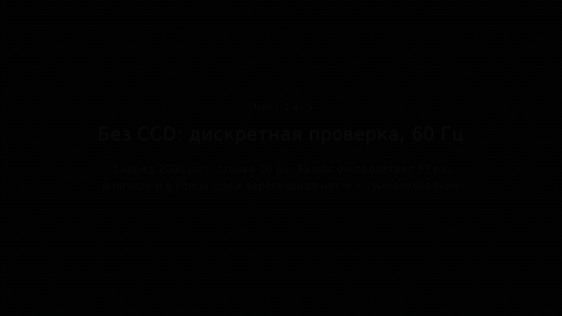

# 2D rigid body: CCD vs Multi-rate

Практическое задание 3, блок «Механика» (курс «Моделирование физических процессов», ИТМО).
Упрощённый 2D-движок для кругов (динамические и неподвижные) и неподвижных AABB-стенок.
Три режима: **Discrete** (60 Гц, проверка пересечения в конце шага), **CCD** (60 Гц, поиск момента
столкновения внутри шага) и **Multi-rate** (обычные объекты 60 Гц, снаряды 60/120/240/480 Гц).

## Сборка в Visual Studio (Windows)

1. SFML 2.6.x для Visual C++ 64-bit должна лежать в `Рабочий стол\SFML-2.6.2`
   (путь задаётся в `Sfml.props`, переменная `SfmlDir`).
2. Открыть `physics2d.sln`, выбрать конфигурацию `Release | x64`, нажать **F5** / Ctrl+F5.
3. Цифры для отчёта (время шага, туннелирование, детерминизм) пересчитываются запуском
   `bin\Release\physics2d.exe --bench` из папки проекта — таблицы в консоль, CSV в `results/`.

DLL SFML и шрифт копируются в `bin\<Конфигурация>\` автоматически после сборки.

## Управление

| Клавиша | Действие |
|---|---|
| `1` / `2` | сцена 1 (снаряд vs тонкая стенка) / сцена 2 (система объектов) |
| `M` | режим: Discrete → CCD → Multi-rate |
| `F` | частота снарядов в Multi-rate: 60 → 120 → 240 → 480 Гц |
| `[` / `]` | коэффициент восстановления e −/+ 0.1 |
| `Up` / `Down` | скорость снаряда ±250 px/с |
| `T` | замедление времени ×1 / ×0.25 / ×0.1 / ×0.02 |
| `Space`, `N` | пауза, один шаг физики на паузе |
| `R` | перезапуск сцены (тот же seed → тот же результат) |
| `C`, `H` | следы снарядов, HUD |

На экране: точки следа — положение центра снаряда в конце каждого шага физики,
зелёные кольца — обработанные удары. HUD показывает ms/кадр, шаги снарядов на кадр,
TOI-события (CCD), счётчики туннелирований и ударов о жёлтую стенку.

## Параметры

Значения по умолчанию — в `src/config.hpp` (e = 0.8, v = 2000 px/с, 60/240 Гц, стенка 10 px,
снаряд r = 5 px, 6 неподвижных r = 36 px, 50 обычных r = 12…24 px, 5 снарядов).

## Структура

- `src/physics.hpp/.cpp` — ядро: интегрирование, дискретный решатель, CCD (TOI круг–круг и круг–AABB), multi-rate.
- `src/main.cpp` — SFML-визуализация, аккумулятор фиксированного шага, интерполяция отрисовки.
- `src/bench.cpp` — замеры E1–E6 для отчёта (режим `--bench`): туннелирование, время шага, устойчивость, детерминизм, масштабирование.
- `media/` — демо-видео и GIF (с титрами перед каждой сценой), три скриншота из отчёта (туннелирование, CCD, демонстрационная сцена).
